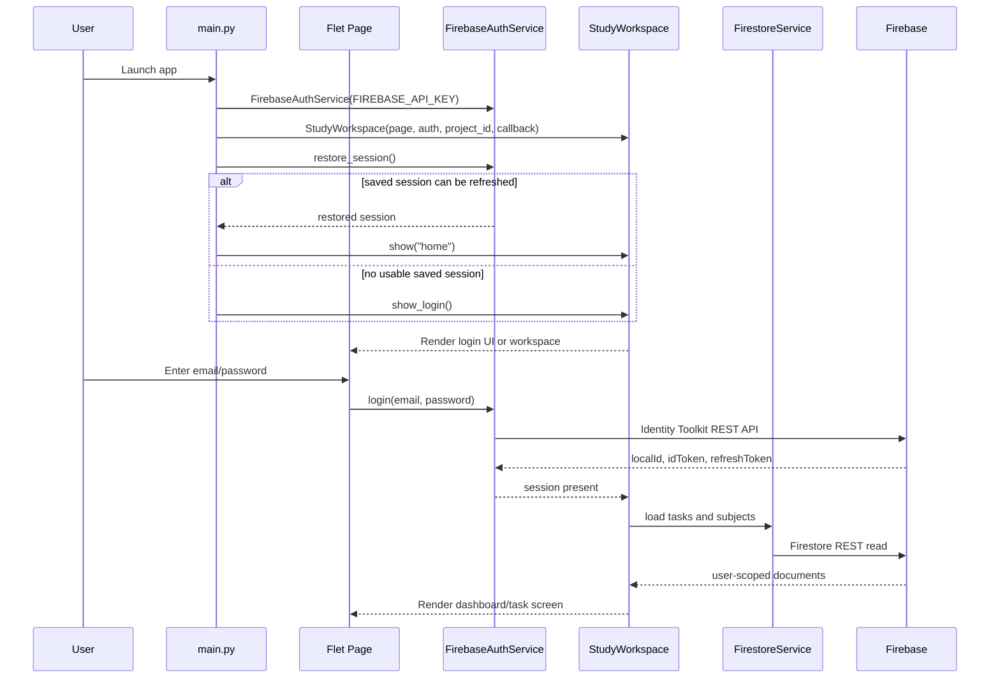
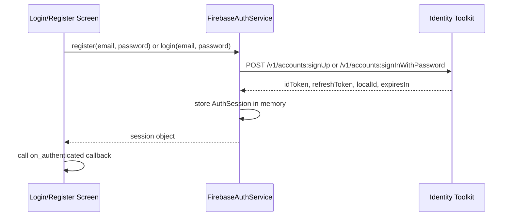
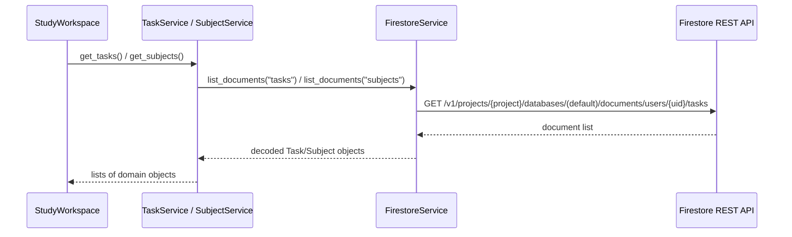
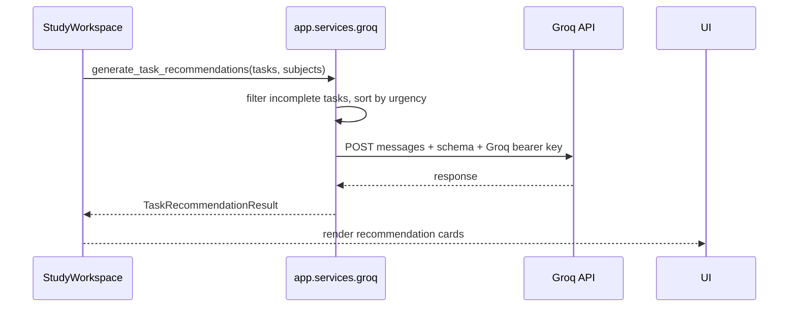

# Architecture

This project is a single-user desktop client built with Python and Flet. It
connects directly to Firebase Authentication and Firestore through REST APIs.
Groq chat and recommendation requests are sent directly from the client to
Groq in both local and Android builds.

## Architectural overview

The runtime is organized around a small set of layers:

- Entry point: `main.py` creates the Flet page and boots the workspace.
- UI layer: `app/ui` renders screens, dialogs, filters, and task/subject actions.
- Service layer: `app/services` wraps Firebase Auth, Firestore, and Groq calls.
- Optional function source: `functions/` contains an authenticated Groq proxy,
  but the app's AI client does not call it.
- Domain layer: `app/models` validates and serializes `Subject` and `Task` objects.
- Configuration: `app/config.py` reads environment variables for Firebase and Groq.

At runtime, `StudyWorkspace` centralizes the app state for the signed-in user. It loads tasks and subjects from Firestore, renders the UI, and triggers Groq recommendations or chat requests with the currently loaded task snapshot.

Newly registered accounts receive two ordinary starter tasks during their
initial workspace load. Completion is recorded in the account's
`workspace_metadata/premade_tasks_v1` document so interrupted setup can retry
without duplicating tasks, and later deletion does not restore them. Existing
accounts are not seeded when they sign in or upgrade.

## Main components

### `main.py`

- Builds a `ft.Page`.
- Creates a `FirebaseAuthService` with the configured API key.
- Creates a `StudyWorkspace` with the Firebase project ID and unauthenticated callback.
- Routes between login, registration, and home view.

### `app.ui.workspace.StudyWorkspace`

This is the largest component in the repo. It owns:

- current route (`home`, `tasks`, `calendar`, `settings`, `profile`)
- cached task list and subject list for the authenticated user
- filter and sort state for the tasks screen
- AI recommendation and chat request state
- all task/subject CRUD actions that call service methods

### `app.services.firebase_auth.FirebaseAuthService`

This service uses the Google Identity Toolkit REST API to sign up or sign in a user with email and password. Successful responses are stored as an `AuthSession` that carries:

- `uid`
- `email`
- `id_token`
- `refresh_token`
- `expires_in`

After authentication, the service saves the email and refresh token in the
user profile directory. On startup, `main.py` calls `restore_session()`, which
uses Firebase Secure Token to obtain a new ID token. Logout deletes the saved
session file.

### `app.services.firestore.FirestoreService`

This service performs all document reads and writes against Firestore using the REST API. It scopes all requests to the authenticated user:

- `projects/{project_id}/databases/(default)/documents/users/{uid}/...`

Every Firestore request is authorized by the current Firebase ID token.

### `app.services.subject_service.SubjectService`

Provides subject CRUD semantics with validation and a guard against deleting a subject that is still assigned to a task.

### `app.services.task_service.TaskService`

Provides task CRUD semantics, validates allowed field changes, ensures the referenced subject exists, and updates the `updated_at` timestamp on task updates.

### `app.services.groq`

Provides two read-only AI functions:

- `generate_task_recommendations(tasks, subjects=None)`
- `chat_about_tasks(message, tasks, subjects=None)`

They send the current task snapshot directly to the Groq Chat Completions API
using `GROQ_API_KEY`. `AI_BACKEND_URL` must be `direct`; Cloud Functions are
not used for AI requests. The key comes from the repository-root `.env` on
desktop or app-private storage configured through Settings on Android. These
functions never write task or subject documents to Firestore.

### `app.services.ai_config`

Loads the repository-root `.env` for local Python runs and reads/writes the
Groq key in `storage_root()/groq-config.json`. On Android, Flet supplies the
app-private base directory through `FLET_APP_STORAGE_DATA`.

### `app.services.study_cache.StudyCache` and `app.ui.theme`

`StudyCache` keeps a per-user local snapshot of task and subject data. At
initial startup, the workspace can show that snapshot while it refreshes from
Firestore. The theme module persists the selected light/dark preference. These
files provide local convenience state, not cross-device synchronization.

### Optional `functions/index.js`

Exports `generateGroq` as an optional authenticated proxy. The desktop and APK
client do not depend on or call it.

## Startup sequence

## UI-to-service interaction

The UI screens call service methods directly from `StudyWorkspace` and the service objects it owns.

Examples:

- `StudyWorkspace._toggle_task()` calls `self.tasks.update_task(...)`.
- `StudyWorkspace._show_task_dialog()` calls `self.tasks.create_task(...)` or `self.tasks.update_task(...)`.
- `StudyWorkspace._request_recommendations()` calls `generate_task_recommendations(...)` with the current cache.
- `StudyWorkspace._send_chat_message()` calls `chat_about_tasks(...)` with the current cache.

The worker pattern is simple: the page renders from in-memory caches, and each dialog action persists through the service layer and then reloads or refreshes the screen.

## Authentication flow

The app does not currently refresh tokens automatically. If the session is invalid or missing, Firestore access raises `AuthenticationRequiredError` and the workspace calls the unauthenticated callback.

## Firestore request flow

Write operations follow the same path with a user-scoped resource path and an ID token in the `Authorization` header.

## AI request flow

The Groq flow is intentionally read-only for task and subject data. Direct
client calls require a key supplied by that desktop or APK user.

## Error-handling strategy

The project uses a layered error approach:

- Domain validation errors raise `ModelValidationError` from `app.models`.
- Service-layer failures raise custom exceptions such as `FirebaseAuthError`, `FirestoreError`, and `GroqServiceError`.
- UI code catches these and displays user-safe explanations.
- Firestore permission errors and expired sessions are converted into user-facing messages without exposing raw Firebase or Security Rules details.

This keeps the presentation layer from dealing with raw network payloads while still surfacing actionable errors.

## State management approach

The app uses a simple in-memory state model:

- The active authenticated session is stored in `FirebaseAuthService._session`;
  a refresh token is also saved locally for startup restoration.
- `StudyWorkspace` retains the current user’s task and subject caches.
- `StudyCache` persists a per-user snapshot for initial rendering while a
  Firestore refresh is pending.
- Routes and filter state are stored on the workspace instance.
- AI request state (`_recommendation_loading`, `_chat_loading`, `_recommendation_result`, etc.) is kept alongside the workspace.

This is local UI state, not a reactive framework store or persistent application database.

## Data ownership and security boundaries

The security boundary is user-scoped to Firebase Auth UID:

- `FirestoreService._user_collection_path()` builds paths under `/users/{uid}/...`.
- `firestore.rules` allows reads and writes only when `request.auth.uid == userId`.
- The task and subject services use only the current authenticated user’s data.

This means tasks, subjects, and any other docs under a user’s tree cannot be accessed by another account.

## External service dependencies

- Firebase Authentication via Identity Toolkit REST API
- Firestore via REST API
- Groq Chat Completions called directly by the client
- Flet for the desktop UI

The app has no general-purpose application backend, queueing system, or local
database. Firebase Cloud Functions are not required for AI requests.

## Notable architectural trade-offs

- Client-side Firebase access keeps the project small and easy to run locally, but it exposes the Firebase web API key and the app’s data access pattern to the client runtime.
- Firestore security is enforced by rules, but the app’s trust model assumes the client only uses the authenticated user’s own data.
- AI recommendations are computed from a task snapshot and never mutate the
  underlying task/subject model.
- Local session, cache, and appearance state improve startup continuity but are
  device-local and not an offline synchronization solution.

## Current implementation status

The repo contains an operational client for:

- login/register
- authenticated Firestore access
- subject/task CRUD
- dashboard and task calendar views
- AI recommendations and chat via Groq
- Firebase security rules and rule tests

The repository is not a full production backend or a multi-user service
platform. It is a Firebase-backed client with direct Groq requests; live Groq
behavior and Android APK builds remain unverified in this repository.
