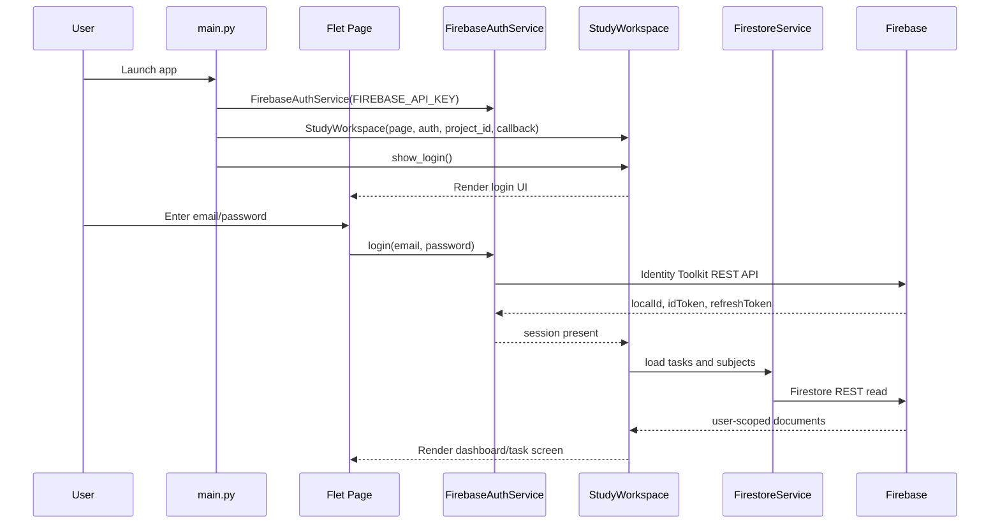
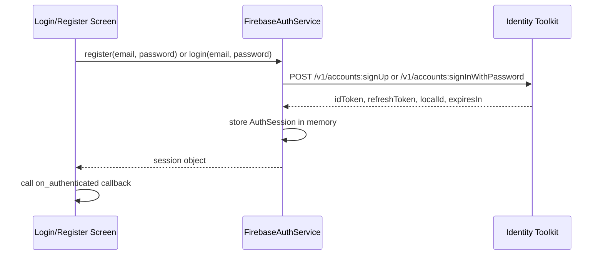
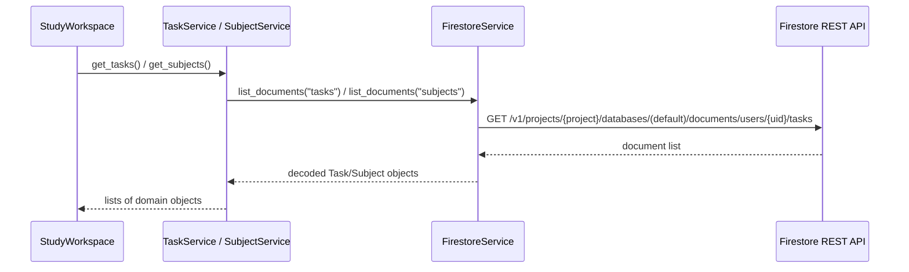
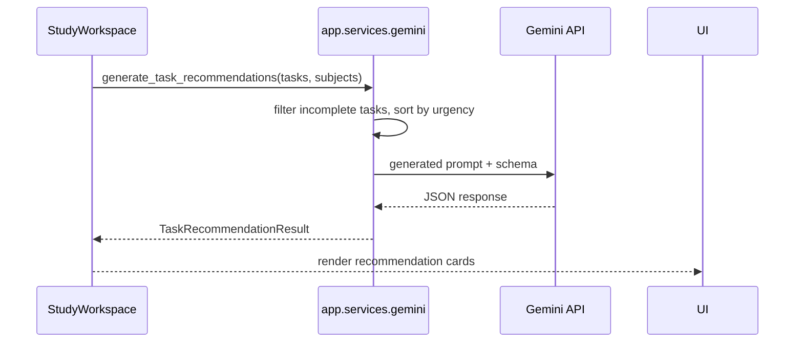

# Architecture

This project is a single-user desktop client built with Python and Flet. It connects directly to Firebase Authentication and Firestore from the client using the Firebase REST APIs. There is no server-side backend or API layer in this repository.

## Architectural overview

The runtime is organized around a small set of layers:

- Entry point: `main.py` creates the Flet page and boots the workspace.
- UI layer: `app/ui` renders screens, dialogs, filters, and task/subject actions.
- Service layer: `app/services` wraps Firebase Auth, Firestore, and Gemini calls.
- Domain layer: `app/models` validates and serializes `Subject` and `Task` objects.
- Configuration: `app/config.py` reads environment variables for Firebase and Gemini.

At runtime, `StudyWorkspace` centralizes the app state for the signed-in user. It loads tasks and subjects from Firestore, renders the UI, and triggers Gemini recommendations or chat requests with the currently loaded task snapshot.

## Main components

### `main.py`

- Builds a `ft.Page`.
- Creates a `FirebaseAuthService` with the configured API key.
- Creates a `StudyWorkspace` with the Firebase project ID and unauthenticated callback.
- Routes between login, registration, and home view.

### `app.ui.workspace.StudyWorkspace`

This is the largest component in the repo. It owns:

- current route (`home`, `tasks`, `calendar`, `settings`, `profile`)
- cached task list and subject list for the authenticated user
- filter and sort state for the tasks screen
- AI recommendation and chat request state
- all task/subject CRUD actions that call service methods

### `app.services.firebase_auth.FirebaseAuthService`

This service uses the Google Identity Toolkit REST API to sign up or sign in a user with email and password. Successful responses are stored as an `AuthSession` that carries:

- `uid`
- `email`
- `id_token`
- `refresh_token`
- `expires_in`

The session is kept in memory only; there is no persistent token cache.

### `app.services.firestore.FirestoreService`

This service performs all document reads and writes against Firestore using the REST API. It scopes all requests to the authenticated user:

- `projects/{project_id}/databases/(default)/documents/users/{uid}/...`

Every Firestore request is authorized by the current Firebase ID token.

### `app.services.subject_service.SubjectService`

Provides subject CRUD semantics with validation and a guard against deleting a subject that is still assigned to a task.

### `app.services.task_service.TaskService`

Provides task CRUD semantics, validates allowed field changes, ensures the referenced subject exists, and updates the `updated_at` timestamp on task updates.

### `app.services.gemini`

Provides two read-only AI functions:

- `generate_task_recommendations(tasks, subjects=None)`
- `chat_about_tasks(message, tasks, subjects=None)`

They send the current task snapshot to Gemini and never write to Firestore.

## Startup sequence

## UI-to-service interaction

The UI screens call service methods directly from `StudyWorkspace` and the service objects it owns.

Examples:

- `StudyWorkspace._toggle_task()` calls `self.tasks.update_task(...)`.
- `StudyWorkspace._show_task_dialog()` calls `self.tasks.create_task(...)` or `self.tasks.update_task(...)`.
- `StudyWorkspace._request_recommendations()` calls `generate_task_recommendations(...)` with the current cache.
- `StudyWorkspace._send_chat_message()` calls `chat_about_tasks(...)` with the current cache.

The worker pattern is simple: the page renders from in-memory caches, and each dialog action persists through the service layer and then reloads or refreshes the screen.

## Authentication flow

The app does not currently refresh tokens automatically. If the session is invalid or missing, Firestore access raises `AuthenticationRequiredError` and the workspace calls the unauthenticated callback.

## Firestore request flow

Write operations follow the same path with a user-scoped resource path and an ID token in the `Authorization` header.

## AI request flow

The Gemini flow is intentionally read-only. The UI passes a snapshot of the user’s tasks and subjects; the AI service never directly writes to Firestore.

## Error-handling strategy

The project uses a layered error approach:

- Domain validation errors raise `ModelValidationError` from `app.models`.
- Service-layer failures raise custom exceptions such as `FirebaseAuthError`, `FirestoreError`, and `GeminiServiceError`.
- UI code catches these and displays user-safe explanations.
- Firestore permission errors and expired sessions are converted into user-facing messages without exposing raw Firebase or Security Rules details.

This keeps the presentation layer from dealing with raw network payloads while still surfacing actionable errors.

## State management approach

The app uses a simple in-memory state model:

- The authenticated session is stored in `FirebaseAuthService._session`.
- `StudyWorkspace` retains the current user’s task and subject caches.
- Routes and filter state are stored on the workspace instance.
- AI request state (`_recommendation_loading`, `_chat_loading`, `_recommendation_result`, etc.) is kept alongside the workspace.

This is local UI state, not a reactive framework store or persistent application database.

## Data ownership and security boundaries

The security boundary is user-scoped to Firebase Auth UID:

- `FirestoreService._user_collection_path()` builds paths under `/users/{uid}/...`.
- `firestore.rules` allows reads and writes only when `request.auth.uid == userId`.
- The task and subject services use only the current authenticated user’s data.

This means tasks, subjects, and any other docs under a user’s tree cannot be accessed by another account.

## External service dependencies

- Firebase Authentication via Identity Toolkit REST API
- Firestore via REST API
- Gemini via Google GenAI client
- Flet for the desktop UI

The app does not use a custom backend, queueing system, or local database.

## Notable architectural trade-offs

- Client-side Firebase access keeps the project small and easy to run locally, but it exposes the Firebase web API key and the app’s data access pattern to the client runtime.
- Firestore security is enforced by rules, but the app’s trust model assumes the client only uses the authenticated user’s own data.
- AI recommendations are computed from a task snapshot and never mutate the underlying data model, which keeps the feature read-only and predictable.
- The app keeps all session and cache state in memory, which is simple but means reloading the app resets the current client-side state.

## Current implementation status

The repo contains an operational client for:

- login/register
- authenticated Firestore access
- subject/task CRUD
- dashboard and task calendar views
- AI recommendations and chat via Gemini
- Firebase security rules and rule tests

The repository is not a full production backend or a multi-user service platform. It is a client-only application with Firebase backend dependencies and mocked/tested service logic.
