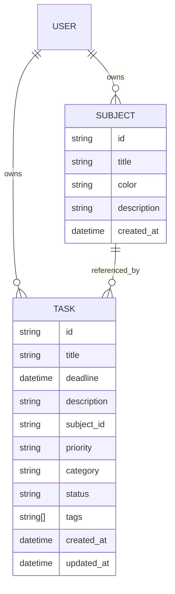

# Data model

The app uses two core domain entities: `Subject` and `Task`. Both are dataclasses stored in Firestore as user-scoped documents under the current authenticated user’s UID.

## Storage model summary

Application data is stored in Firestore under this path pattern:

```text
/projects/{project_id}/databases/(default)/documents/users/{uid}/subjects
/projects/{project_id}/databases/(default)/documents/users/{uid}/tasks
```

The app does not define a separate `users` collection schema beyond the user-scoped storage path. The actual user identity is the Firebase Auth UID, not a persisted app-specific profile model.

## Subject entity

Source: `app/models/subject.py`

| Field | Type | Required | Default | Notes |
| --- | --- | --- | --- | --- |
| `id` | `str` | Yes | n/a | Firestore document ID |
| `title` | `str` | Yes | n/a | Subject name |
| `color` | `str` | Yes | `#2196F3` when reading from Firestore | Hex-style color string |
| `description` | `str` | No | `""` | Optional free-form text |
| `created_at` | `datetime` | Yes | n/a | Timezone-aware UTC timestamp |

### Validation rules

- `id` must be a non-empty string.
- `title` must be a non-empty string.
- `color` must be a non-empty string.
- `description` may be empty but must be a string if present.
- `created_at` must be timezone-aware and converted to UTC.

### Firestore representation

`Subject.to_firestore()` serializes to:

```python
{
    "title": self.title,
    "color": self.color,
    "description": self.description,
    "created_at": self.created_at.isoformat(),
}
```

The document ID is the `Subject.id`, and `created_at` is stored as an ISO 8601 string with timezone information.

### Relationships

A subject is referenced by tasks via the `task.subject_id` string. This is a loose relationship and not enforced by Firestore schema. The repository intentionally checks in `SubjectService.delete_subject()` to avoid deleting an in-use subject.

## Task entity

Source: `app/models/task.py`

| Field | Type | Required | Default | Notes |
| --- | --- | --- | --- | --- |
| `id` | `str` | Yes | n/a | Firestore document ID |
| `title` | `str` | Yes | n/a | Task summary |
| `deadline` | `datetime \| None` | No | `None` | Optional timezone-aware deadline |
| `description` | `str` | No | `""` | Details for the task |
| `subject_id` | `str \| None` | No | `None` | Optional related subject |
| `priority` | `str` | No | `"medium"` | One of the app’s supported values |
| `category` | `str` | No | `"general"` | Free-form category text |
| `status` | `str` | No | `"pending"` | App status values: `pending`, `in_progress`, `completed` |
| `tags` | `list[str]` | No | `[]` | Comma-separated tags in UI |
| `created_at` | `datetime` | Yes | `now_utc()` | Creation timestamp |
| `updated_at` | `datetime` | Yes | `now_utc()` | Last modification timestamp |

### Validation rules

- `id` and `title` must be non-empty strings.
- `description` can be empty but must be a string.
- if `subject_id` is set, it must be a non-empty string.
- `priority`, `category`, and `status` must be strings.
- `tags` must be a list of strings.
- `deadline`, `created_at`, and `updated_at` must be timezone-aware.

### Firestore representation

`Task.to_firestore()` serializes to:

```python
{
    "title": self.title,
    "description": self.description,
    "subject_id": self.subject_id,
    "deadline": self.deadline.isoformat() if self.deadline else None,
    "priority": self.priority,
    "category": self.category,
    "status": self.status,
    "tags": list(self.tags),
    "created_at": self.created_at.isoformat(),
    "updated_at": self.updated_at.isoformat(),
}
```

The Firestore layer encodes Python objects into Firestore field values. Timestamps are stored as ISO 8601 strings, not native Firestore timestamps.

## Relationship model

### One-to-many subject-to-task relationship

The actual relationship is logical rather than schema-enforced:

- subject documents live under `/users/{uid}/subjects/{subject_id}`
- tasks live under `/users/{uid}/tasks/{task_id}`
- each task may include a `subject_id` pointing to a subject document

The app enforces this relationship through application code:

- `TaskService._require_subject()` verifies the subject exists before saving a task with a subject reference.
- `SubjectService.delete_subject()` refuses deletion if any task references the subject.

### Tag and category behavior

The UI accepts task tags as a comma-separated string and stores them as a list of strings in Firestore. Category is a free-form string defaulting to `general` and is used in filtering.

## User ownership model

There is no project-level `User` model. Instead, the app uses the Firebase Auth `uid` as the tenant boundary.

Firestore paths are created as:

```text
/users/{uid}/subjects
/users/{uid}/tasks
```

All user operations are scoped to this UID by `FirestoreService._user_collection_path()`.

## Server-managed AI usage record

When the Cloud Function is deployed, it writes one usage document per user at:

```text
/_gemini_usage/{base64url(uid)}
```

The document contains the current UTC `day`, the accepted request `count`, and
an `updatedAt` server timestamp. It is used only to enforce the function's
30-request daily limit. The Admin SDK writes it outside the client-side task
and subject model, and it should not be treated as a user profile or exposed in
the app UI.

## Document ID strategy

The repo uses either:

- a caller-provided document ID when the application explicitly passes one, or
- a generated ID when the service creates a new document without a provided ID

Examples from the service layer:

- `TaskService.create_task(..., task_id=...)`
- `SubjectService.create_subject(..., subject_id=...)`

If no explicit ID is supplied, the Firestore create operation uses the server-side generated value, and `create_document()` returns that generated ID.

## Creation and modification behavior

### Subject creation

- `SubjectService.create_subject()` creates an object with `created_at=now_utc()`.
- it then persists it to Firestore.
- it returns the newly created `Subject` object using the document ID returned by Firestore.

### Subject update

- `SubjectService.update_subject()` accepts a subset of fields: `title`, `color`, `description`.
- it does not keep a separate `updated_at` timestamp for subjects.

### Task creation

- `TaskService.create_task()` creates a `Task` with `created_at` and `updated_at` both set to the current UTC time.
- it validates subject ownership before persisting if `subject_id` is set.

### Task update

- `TaskService.update_task()` merges the provided fields into the existing object and always updates `updated_at` to `now_utc()`.
- it validates allowed task fields and subject existence if the subject changes.

## Deletion behavior

- `TaskService.delete_task()` deletes a task document by ID.
- `SubjectService.delete_subject()` refuses deletion when a task still references the subject.

No soft-delete model or archival pattern is implemented.

## Data model diagram



## Important differences between Python models and Firestore documents

The Python data classes and Firestore documents are intentionally close, but they are not perfectly identical:

- Firestore stores values in encoded field structures, which the Firestore service decodes back into Python objects.
- `Task.deadline` is a Python `datetime` object with timezone awareness; Firestore stores it as an ISO string.
- The app’s domain layer validates and parses values; Firestore itself is trusted only after decoding.
- Some Firestore field names are also app-level names (`subject_id`, `status`, `tag`, etc.) with no separate schema abstraction.

This is a straightforward REST-backed document model, not a relational or ORM-based schema.

## Unverified or absent data model elements

The repository does not contain verified implementations of:

- project-level user profiles
- billing or subscription data
- AI-generated task metadata persisted to Firestore
- task comments or notes beyond `description`
- multi-user admin roles

Those are either not implemented or not present in the checked-in code.
